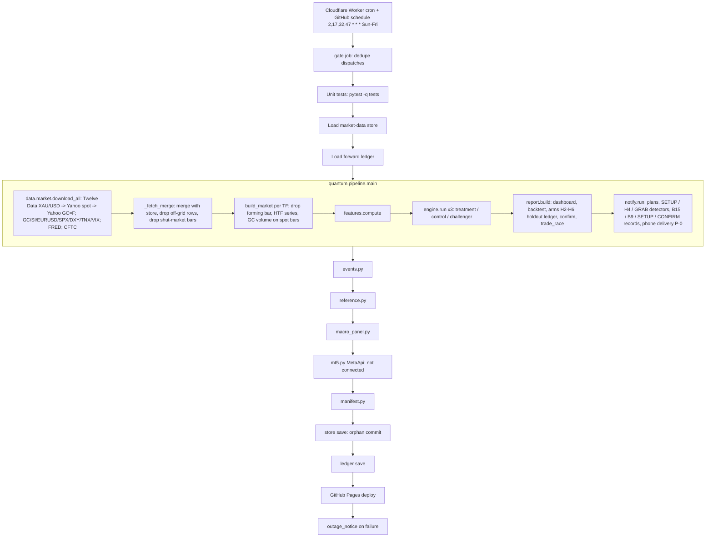

# Independent audit — XAUUSD Quantum platform (read-only, 2026-11-14)

**Scope.** The production system as deployed: branch `claude/audit-prompt-real-artefacts-nekqv6` at `51f9142d8`
(engine `Q7.2-web.8`, config hash `5e4630924d663fc5`, freeze key `5e4630924d663fc5:a6f2be58c74887ed`), its data
branches (`market-data` `5e3309bc2`, `forward-ledger` `90c3f772e`, `research-data` `a0d74e498`) and the research record.

**Method.** Everything was executed on copies, in an isolated worktree. Nothing was merged, deployed, configured or
deleted. No production engine, threshold, parameter, record or registration was changed. Every number below comes from a
command that was run. The scripts are in `audit/tools/ia/` and their outputs in `docs/audit/ia_2026-11-14/` (aggregates
only, no vendor price data).

**Verdict in one line.** The software is largely correct and reproducible. The **trading claim is not supported**:
- no strategy (breakout, sweep, engine composite) has shown an edge over a matched random entry, on development data or live;
- the engine's probability is not calibrated;
- the phone alert shows a historical record the project's own research has already corrected.

**NO VALID SIGNAL — NO TRADE.**

---

## A. Executive summary

| Area | Status | Evidence (section) |
|---|---|---|
| Overall health | **Software: sound with defects. Trading use: NOT VALIDATED** | all |
| Production status | Live on `51f9142d8`. Run 3278 green. Runs every 15 min, Sun–Fri. Phone delivery to the device UNVERIFIED (no acknowledgement exists) | C.6 |
| Critical risks | **IA-01**: the phone RECORD line shows retracted statistics. **IA-02**: an uncalibrated probability drives the EV / calibration gates and sizing | J |
| Major architecture issues | Strategy detection lives inside the 2,997-line alert module. The engine is one function of cyclomatic complexity 1,050. Two different trade plans are shown for the same signal | B, J |
| Strategy validity | Breakout and sweep are **explicitly defined and tested; no edge** (development n ≈ 6–7k each, at random). Live: no stream beats a same-period random entry | D, F |
| Data reliability | Spot XAU/USD (Twelve Data) is internally consistent: 0 duplicates, 0 open-hour holes, exact cross-timeframe aggregation. **No independent spot reference** (only premium-adjusted futures). Vendor revises closed bars and payloads are not archived | C |
| Mathematical validity | 43 of 45 indicator checks PASS against an independent re-implementation. **FAIL: weekly high/low (PWH/PWL) defect**, inherited from the frozen Pine model. Risk arithmetic 10/10 PASS | E |
| Statistical validity | Look-ahead: none found (prefix-invariance test, 6 cuts). Labellers reproduced (135/135 recorded outcomes). **Probability calibration FAIL** (p = 0.00017). Forward samples are small (B15: 13) | F |

### What a trader needs to know first

1. **The "64% of 70 / 61% of 44" on every engine alert is not a valid record.** The research corrected it to 52.2% of 23
   (2020–22) and 45.8% of 24 (2023–24) once signals are counted per idea (`research/STRATEGY_CATALOGUE.md` row
   "B10 / B13-1 (corrected)"). Live results are 5 of 13 (38.5%, B15). In the same days, random SELL entries won 61.9%.
2. **The engine's probability overstates its odds.** It averaged 62.5% on 43 unique live trades; 34.9% won. It scores
   worse than the plain no-edge geometry (Brier 0.318 vs 0.233).
3. **Breakout and sweep, the two strategies the brief names, are already coded with exact rules and tested.** On
   2020–22 they won 46.1% (n 6,729) and 46.6% (n 5,918) against 46.2–46.3% for random entries.
   - Last week's live 15m breakouts won 33/48. That was a trend week: 39 of the 48 were SELLs while gold fell about
     $190, and random entries in the same days won 56.6% (p = 0.059).
   - **That is not evidence of an edge.**
4. A $10–$20 move "after the trigger" is common in **any** direction; that is volatility, not skill. Before a −$13 stop,
   the no-edge odds are fixed by geometry: +$10 56.5%, +$15 46.4%, +$20 39.4%. Nothing measured beats them.

---

## B. Architecture audit

### B.1 Actual execution flow (production workflow `.github/workflows/quantum-site.yml`)



### B.2 Engine dependency and execution map

| Engine | Input | Output | Depends on | Order | Status |
|---|---|---|---|---|---|
| Data (`data/market.py`, `data/sources.py`, `data/store.py`) | Vendor APIs, store CSVs | Spot OHLC per TF, GC volume, aux series, status | — | 1 | PASS: filters verified (C.2). Twelve Data is the only price source used in 3,752 records |
| Calendar / sessions (`sessions.py`) | Bar open times | Trading day (NY 17:00), DST flags, sessions | Data | 2 | PASS (IANA zoneinfo; DST transition 2026-11-01 inside the window) |
| Features (`features.py`, `ta.py`) | Market | EMA / ATR / RSI / ADX / BB / VWAP, HTF scores, macro features | Data, sessions | 3 | PASS (E.1) |
| Engine (`engine.py`, `analog.py`) | Features | Scores, levels, BOS / CHoCH / MSS / SWEEP / SIGNAL / VETO events, plan, p, EV | Features | 4 | PASS on look-ahead; **FAIL** PWH/PWL (E.2); **p not calibrated** (F.3) |
| Report (`report.py` + arms H2–H6, `backtest.py`, `confirm.py`, `trade_race.py`, `holdout.py`) | Engine results | Site payload, holdout ledger | Engine | 5 | PASS (strict JSON; prefix-invariant) |
| Alerts and strategy detectors (`notify.py`, `confirm_panel.py`, `fwd_b24.py`) | All payloads, store state | Phone messages, SETUP / H4 / GRAB / B15 records | Report | 6 | Delivery logic PASS (mutation 41/41). **Content issues** (H.2) |
| Display-only steps (`events`, `reference`, `macro_panel`, `mt5`) | Network | site/data/*.json | — | 7–10 | Non-fatal by design. **MT5 not connected** |
| Bookkeeping (`manifest.py`, store / ledger saves) | Store, ledger | Run manifest (commit, freeze key, env versions) | All | 11–13 | PASS: the 14 Nov manifest records commit `51f9142d8`, the freeze key and python 3.11.18 / numpy 2.4.6 / pandas 3.1.1 |

**Order check.** The pipeline runs data → features → engine → report → notify in one process. The notifier only receives
completed payloads (`pipeline.py:97-99`). A timeframe whose build raises is excluded from `payloads`, so it cannot reach
`notify` (`pipeline.py:79-84`). However, the run still exits 0 if any timeframe succeeded (`pipeline.py:102`): partial
failure shows only in `index.json` → `errors` (IA-19).

### B.3 Static analysis (production package `quantum/`, research excluded)

| Tool (version) | Result | Assessment |
|---|---|---|
| import graph (AST, `audit/tools/ia/imports.py`) | 60 modules; 1 cycle `notify ↔ confirm_panel ↔ fwd_b24` | Benign: `notify` imports the other two inside a function (`notify.py:2915, 2921`). Low |
| pyflakes 4.1.0 | 6 warnings, 2 in production: `arm_h4.py:19` unused numpy, `arm_h2.py:89` unused local | Low |
| ruff 0.16.9 (E9,F,B,BLE,S110,S112,PLE) | 30× B023, 36× B905, 5× B007, 1× S112, 1× BLE001, 1× F841, 1× F401 | **All 30 B023 reviewed**: each closure is defined and called inside the same iteration (`engine.py:362-366, 719-756`, `backtest.py:44-45`, `features.py:505`, `market.py:171`) → false positives |
| broad `except Exception` (AST) | 33 handlers; 2 silent (`macro_panel.py:59`, `manifest.py:146`) | Both display / bookkeeping only. Low |
| radon 6.0.1 | `engine.run` CC **1,050**; `notify._run` 180; `notify._publish` 72; `engine.trade_plan` 61 | Maintainability / testability risk (IA-15). The engine is a line-by-line Pine port |
| bandit 1.9.4 (medium+) | `events.py:67` XML `fromstring` (B314); `outage_notice.py:81,88` urlopen (B310) | Low: expat does not resolve external entities; URLs are constants |
| vulture 2.16 (≥ 60%) | 18 items (dead-code report, B.4) | See B.4 |
| pip-audit 2.10.1 | No known vulnerabilities (requirements.txt) | requirements are **unpinned** (`numpy>=1.26`, `pandas>=2.2`). Production runs pandas 3.1.1 (IA-21) |
| mypy 2.3.1 | **NOT RUN** (the code base has no type configuration; a run would mostly report missing stubs) | — |

### B.4 Dead-code and unused-variable report (each traced before classification)

| Symbol | Where | References | Classification |
|---|---|---|---|
| `commission_per_oz` | `config.py:105` | none in code | **Unused config field.** The backtest charges `commission_l` instead. It sits in the config hash, so removing it restarts the holdout. Keep it and document it |
| `price_to_money`, `money_to_price`, `lots_for_risk`, `trade_money`, `round_price` | `contract.py:59-91` | tests only | Python mirror of `site/costs.js`, kept for the parity test `tests/costs.test.mjs`. Not dead; document |
| `round_trip_cost_per_oz` | `cost_profiles.py:89` | tests only | As above |
| `plan_result` | `notify.py:1586` | tests only | Reference implementation used by tests. Review whether production should call it |
| `verify_events` | `confirm_panel.py:579` | tests only | Audit helper |
| `SEEN_SEC` | `confirm_panel.py:57` | none | Unused constant. Low |
| `ARM` | `arm_h2..h6` | none in Python | Module labels. Informational |
| `_empty` | `data/sources.py:73` | none | Unused helper. Low |
| `now_utc` | `news_calendar.py:61` | none | Unused helper. Low |
| `o` | `arm_h2.py:89` | assigned, never read | Low |

No unreachable signal path was found. Pine-side dead code is tracked by `audit/tools/deadcode.py` (`retained.txt`,
operator instruction 2026-09-26: do not delete features).

---

## C. Data audit

### C.1 Providers (code-verified, `data/market.py:153-216`)

| Field | Source | Instrument | Role | Verified |
|---|---|---|---|---|
| Price OHLC (5m, 15m, 30m, 1h, 1d) | Twelve Data `XAU/USD` (when the key is set); fallbacks Yahoo `XAUUSD=X` → Yahoo `GC=F` | **Spot** (fallback: COMEX futures) | Engine price | All 3,752 holdout records carry `twelvedata:XAU/USD`. **Fallback never used in the record** |
| Volume | Yahoo `GC=F` volume reindexed on spot bars | **COMEX futures** | Volume gates (BOS needs volume > 1.2× SMA20) | Instrument mixing by design, labelled `volume_source`. Spot has no traded volume |
| Silver, EUR/USD, S&P, DXY, US10Y, VIX | Yahoo (`SI=F`, `EURUSD=X`, `^GSPC`, `DX-Y.NYB`, `^TNX`, `^VIX`) | Mixed | Macro / correlation layers | Store counts in C.2 |
| DGS2, DFII10 | FRED (shifted +1 day: published after the observation) | — | Daily macro | Code reviewed |
| COT | CFTC, indexed at **public release time** (no as-of-date look-ahead) | — | Positioning | Code reviewed |
| Bid / ask / spread | **None.** MetaApi MT5 module exists (`mt5.py`) but no `MT5_*` series exists in the store | — | — | **NOT CONNECTED → spread is modelled, never measured** |

### C.2 Completeness and integrity (`audit/tools/ia/data_audit.py`, `align_audit.py`)

| Check | Result |
|---|---|
| Duplicates, out-of-order rows, OHLC inconsistencies, NaN OHLC | **0 in every one of 26 series** |
| Twelve Data quotes while gold is shut (raw store, Fri 17:00 → Sun 17:00 NY) | 15m 2,759 of 9,670; 5m 5,397 of 19,012; 60m 1,744 of 6,167; 1d 172 weekend-dated rows. **Dropped before the engine** by `sources.trading_week_only` (`market.py:131`), which also drops the 17:00–18:00 NY daily break. PASS |
| Holes inside open hours after that filter | 5m 0 / 15m 0 / 30m 0 / 60m 0 |
| Cross-timeframe aggregation (production-filtered store) | 5m→15m (4,350 bars), 15m→30m (3,312), 30m→60m (1,887), 15m→60m (1,656): **max \|difference\| 0.00** on O, H, L and C |
| 4h boundary | New York-anchored: 01, 05, 09, 13, 17, 21 NY (= MT5 servers on New York close) |
| Daily boundary | **Two conventions** (IA-20): PDH / PDL / PWH / PWL from intraday bars on the **NY 17:00** trading day (`sessions.py:30-33`); the daily HTF trend layer and previous-month levels from Twelve Data **UTC-midnight** daily bars (`market.py:245-257`) |
| DST | IANA zoneinfo (`sessions.py`). The US transition of 2026-11-01 is inside the 15m window; no hole and no duplicate around it |
| Run cadence, November, open market (manifests) | 910 runs. Gap median 14.95 min, p95 17.0. Gaps over 45 min: 9 at the daily or weekly reopen (by design), **one 570-minute outage on 10 Nov** (documented incident), one 50-minute gap on 11 Nov |
| Revisions | Run 43606137153 recorded 15 revised closed bars (11 files, incl. `XAU_USD_5m`). Payloads are not archived per run, so a past decision cannot be replayed exactly as it was seen (IA-12) |

### C.3 Independent price reference

- **Workflow run `43599943057` (14 Nov) compared Twelve Data with COMEX `GC=F`, futures premium removed (median $9.37):**
  - 1h: 345 matched bars; median \|close difference\| $0.674 (1.69 bps); p95 $2.69; max $13.76 (Friday close);
  - return correlation 0.974, sign agreement 94.5%, best lag 0.
- **Consistent, but this is not an independent spot reference.** Dukascopy refuses GitHub's addresses and Yahoo spot
  returns 404 (`audit/tools/xcheck_dukascopy.py` header). MT5 is not connected.
- **Live spot accuracy against the operator's broker is UNVERIFIED** (IA-11).

---

## D. Strategy audit

### D.1 Strategy A — PRICE BREAKOUT: exact definitions found in code

| Implementation | Definition (verbatim logic) | File |
|---|---|---|
| SETUP BREAKOUT (15m, B16) | BUY: `close[i] > L >= close[i-1]` for L ∈ {PDH, PWH, PMH, today's high so far, last closed 4h high, last closed 1h high}, **and** `close > VAH`, **and** not inside a bear order block. SELL mirrors. One event per level and direction per trading day | `notify.py:892-1003` |
| 4H BREAKOUT (B18) | closed 4h candle closes above the previous 4h high (below the low). Four checks: beyond a PD / PW / PM level, 3/3 trend votes, engine bias, London / NY close | `notify.py:1018-1047` |
| Engine BOS (internal) | close beyond the snapped swing level by > 0.15 ATR. Body > 0.30 ATR, body share > 70%, volume > 1.2 × SMA20 × regime multiplier, ADX gate | `engine.py:356-399` |

**Against the brief (§2A):**
- **Measured:** closes (not wicks), the level set, HTF context via the 4-check variant, and the body ratio, ATR and
  volume (engine BOS only).
- **Not in the SETUP breakout:**
  - minimum distance beyond the level (any close-cross counts);
  - body / ATR filter;
  - retest;
  - spread at the breakout (no spread data exists);
  - previous 30m / 15m candle levels as breakout levels.

### D.2 Strategy B — LIQUIDITY SWEEP: exact definitions found in code

| Implementation | Definition | File |
|---|---|---|
| SETUP SWEEP (15m, B16) | BUY: `low[i] < L < close[i]` for a low-side level, and L lies in a bull order block / value-area low / POC (±$3). SELL mirrors | `notify.py:906-917` |
| Engine SWEEP → B9-GRAB-FWD | `high >= p and close < p` for p ∈ {PDH, PWH, PMH} (mirror for lows). One trade per pool per day | `engine.py:796-801`, `notify.py:739-762` |
| CHoCH / MSS (engine) | Prior trend + higher low (lower high) + bar spacing + ADX check; MSS additionally requires the swing sequence | `engine.py:401-425` |

**Against the brief (§2B):**
- **Implemented:** penetration as a wick through and a close back; levels PDH / PDL / PWH / PWL / PMH / PML, EQH / EQL
  (scoring), session highs / lows (session-sweep flag, `engine.py:327`); CHoCH / MSS as separate events.
- **Not implemented as sweep conditions:**
  - minimum or maximum penetration distance;
  - rejection-wick ratio;
  - displacement after the sweep;
  - structure shift within N bars;
  - retest;
  - Asian / London / NY range sweeps as SETUP levels;
  - 1h / 30m / 15m swing-pool sweeps.
- **The distinctions the brief asks for are not encoded.** These are penetration vs sweep vs sweep with rejection vs
  confirmed sweep vs failed sweep.

### D.3 Multi-timeframe structure

- **Per-chart-timeframe engine (5m, 15m, 30m, 1h, 4h):**
  - each run computes its own swings, BOS / CHoCH / MSS, pools and distances;
  - HTF layers read `close[1]` and EMAs of the last HTF bar opened before the chart bar's close (`market.py:75-109`);
  - completed vs forming bars are split by `sources.drop_incomplete` (`sources.py:277-285`); the forming bar is display only.
- **Look-ahead: none found** (F.1).
- **Not implemented** as named per-timeframe fields:
  - a single table of previous-candle H / L / C for every timeframe;
  - HH / HL / LH / LL labels.

### D.4 What production actually sends

- The phone default is `ALERT_MODE=sixty` (`notify.py:1056-1068`): only **15m engine composite signals** and their
  follow-ups reach the phone.
- Breakout and sweep setups are website-only, unless all four B17 checks pass and the mode is `quality`.
- The **primary production decision is not either strategy in the brief**. It is the composite engine signal: scores,
  plus the gates TQ floor, EV ≥ 0, calibration gate and risk lock (`engine.py:1336-1392`).
- Every rejection has a traced reason: VETO events carry `why ∈ {RISK, P, EV, TQ}`, and DECISION events carry
  `from → to` (PASS, prompt §6).
- **The gates themselves rest on the uncalibrated p and on the engine's own plan** (IA-02, IA-04).

---

## E. Mathematical audit

### E.1 Formula and variable register (independent re-implementation, `audit/tools/ia/indep_indicators.py`; no `quantum` import)

The values compared are the engine's published chart series in production-equivalent payloads (offline rebuild,
14 Nov 15:00 UTC). Recursive indicators are compared after a 1,200-bar warm-up. The tolerance is the payload rounding.

| Variable (payload key) | Definition | Formula | Units | 15m | 1h | 4h |
|---|---|---|---|---|---|---|
| `ema20/100/200` | Exponential MA of close | α = 2/(n+1); eₜ = αcₜ + (1−α)eₜ₋₁ | $ | PASS (300) | PASS | PASS |
| `rsi` | Wilder RSI 14 | 100 − 100/(1 + RMA(gain)/RMA(loss)) | 0–100 | PASS | PASS | PASS |
| `adx` | Wilder DMI / ADX 14 | RMA of DX; DX = 100\|DI⁺−DI⁻\|/(DI⁺+DI⁻) | 0–100 | PASS | PASS | PASS |
| `bb_mid / bb_up / bb_lo` | Bollinger 20, 2 | SMA20 ± 2 × population sd | $ | PASS (1,480) | PASS | PASS |
| `vwap / wvwap / mvwap` | Anchored VWAP (NY day / ISO week / month) | Σ(hlc3 × v)/Σv since the anchor | $ | PASS | PASS | PASS |
| `pdh / pdl` | Previous NY-17:00 trading day high / low | max / min of the previous trading day's bars | $ | PASS (1,380) | PASS | PASS |
| `pwh / pwl` | Previous trading week high / low | max / min of the previous ISO week (of the trading date) | $ | PASS (920) | PASS (1,380) | **FAIL**: 210 / 1,050 bars (max $18.61) and 30 / 1,050 (max $30.29) |

### E.2 Defect IA-05: PWH / PWL omit the first bar of every trading day except the week's first

- **Code:** `engine.py:294-306`. On `crossed_day` the daily accumulators reset. The weekly accumulators update only when
  `crossed_week` is also true; otherwise that bar's high / low **never enter the weekly range**.
- **Test of the hypothesis** (`pwh_check.py`): excluding exactly those bars reproduces the engine's PWH / PWL with
  **0 differences** on every timeframe.
- **Effect:** on 4h, **9 of 37 weeks** had a wrong previous-week high or low (largest error $30.29). On 15m / 1h the
  first bar is short and no week in the window was affected, but the defect is present.
- **Origin:** identical in the frozen Pine reference (`artefacts/XAUUSD_Quantum_5_0_Master.pine:657-666`). A faithful
  port of a model defect, not a port error.
- **Reach:** PWH / PWL feed liquidity scoring (weight 1.25), the engine sweep, SETUP levels, B18 checks and trade-plan
  stop / target candidates.
- **Fixing it is an engine change.** It goes through an amendment and restarts the holdout (CLAUDE.md non-negotiables).
  No existing test covers it.

### E.3 Risk and plan arithmetic (independent, all PASS)

| Check | Engine | Independent |
|---|---|---|
| Stop distance = $650 / (0.5 lot × 100 oz) | 13.00 | 13.00 |
| TP1 / TP2 distance | 13.00 / 20.00 | 13.00 / 20.00 |
| Round-trip cost at $26 / lot × 0.5 | $13.00 | $13.00 |
| BUY 4300 stop; SELL 4300 TP | 4287 / 4287 | 4287 / 4287 |
| Break-even P(TP1 first) = (SL$ + cost)/(SL$ + TP$) | 0.510 | 0.510 |
| No-edge P(TP1 first) = SL/(SL + TP) | 0.500 | 0.500 |
| No-edge P(TP2 \| TP1, stop at entry) = TP1/TP2 | 0.650 | 0.650 |
| $ per $1 move per lot | 100 | 100 (**contract spec status UNVERIFIED**, `contract.py:23`) |
| Alert ladder (+$10 / +$13 / +$15 / +$20 before −$13) | 57 / 50 / 46 / 39% | 56.5 / 50.0 / 46.4 / 39.4% |
| Two stops in a day vs a 5% limit on $25,000 | −$1,326 = 5.3% | −$1,326 = 5.3% |

**Cost inconsistency (IA-06).** The phone plan and B15 use $0.26/oz round trip (`notify.py:13`, `confirm_panel.py:58`).
The engine, every arm and ledger, and the research use spread (0.18–0.50) + 2 × 0.20 slippage + $7 per lot, i.e.
$0.65–0.97/oz (`config.py:39-41`, `features.py:260`). Break-even at ±$13:

| Round-trip cost | Break-even |
|---|---|
| $0.26/oz | 51.0% |
| $0.65/oz | 52.5% |
| $0.77/oz | 53.0% |
| $0.97/oz | 53.7% |

Neither figure is verified against a broker deal.

**Kelly (IA-13).**
- The dashboard sizes with half-Kelly on the Wilson lower bound of the engine's own rolling statistics, capped at
  `risk_percent` (`report.py:51-99`).
- The input win rate comes from the engine's self-labelled plan outcomes, not from a validated forward record.
- Prompt §11 forbids this until validated. The cap limits the damage.

---

## F. Statistical audit

### F.1 Look-ahead: prefix-invariance test (`truncate_store.py`, `lookahead_cmp.py`)

**Method.**
- Build stores containing only bars **closed** by T (T = 10 Nov 12:00 and 5 Nov 15:30 UTC).
- Rebuild the payloads with the production code.
- Compare every published per-bar series and event with a rebuild on the full store.

**Result.**
- 15m / 1h / 4h: 922–1,421 common closed bars per comparison and 34 series each; **0 differences**.
- Markers identical (81–434 per comparison).
- The only differences are decisions that fell out of the payload's 40-item display list (all older than the full list's
  first item).
- **PASS.**

**Limit.** This tests the code, not the data. The store holds the vendor's latest, revised bars, so whether a live
decision would change after a revision is UNVERIFIED (IA-12).

### F.2 Outcome labellers reproduced (`relabel.py`, `live_moves.py`; independent of `quantum`)

Rule: TP before SL on raw 5m spot bars. When both are touched in one bar it is a loss, unless the bar opened beyond the
target. Shut-market quotes are removed.

| Record | Recorded = independent result | Resolution time |
|---|---|---|
| B15-ENGINE-FWD (±$13) | **13 / 13** | 13 / 13 |
| `plan_validation.json` | **23 / 23** | 20 / 23 (the 3 differences are early records, 1–2 Nov, written before the `path` field existed; result identical, cause of the time difference not established) |
| SETUP-LIVE (+$15 / −$13) | **99 / 99** | — |

### F.3 Probability calibration: engine `p` at entry (treatment ledgers, 5 timeframes, unique trades)

| Sample | Unique trades | TP1 hit | Mean engine p | Exact P(X ≤ hits \| p) | Brier: engine vs no-edge geometry | Log loss: engine vs geometry |
|---|---|---|---|---|---|---|
| Archive keys | 32 | 11 (34.4%) | 0.618 | 0.0012 | 0.329 vs 0.224 | 0.875 vs 0.638 |
| Current key | 11 | 4 (36.4%) | 0.645 | 0.052 | 0.284 vs 0.261 | 0.758 vs 0.714 |
| **All** | **43** | **15 (34.9%)** | **0.625** | **0.00017** | **0.318 vs 0.233** | **0.845 vs 0.657** |

**Reliability:** p 0.60–0.65 → 3/12 won; p ≥ 0.70 → 2/7 won. Higher p does not mean more wins. **FAIL**, consistent with
the 13 Nov stage-2 verification (39 trades, p = 0.00061; minor differences in de-duplication).

**The research's calibrated models fared no better.** B22 tested 42 model / calibration combinations: AUC 0.47–0.51, and
none beat quoting the base rate (`research/B22_RESULTS.md`).

### F.4 Live forward results per strategy

All rows: entries recorded by the system, outcomes labelled independently on 5m spot bars, horizon 1 trading day.
Wilson 95% intervals. Random = same days, same direction mix, 40× the count.

| Stream | n | +$10/−13 | +$13/−13 | +$15/−13 | +$20/−13 | Non-overlapping ±13 | Random ±13 (p, one-sided) | Median MFE / MAE, 1 day |
|---|---|---|---|---|---|---|---|---|
| A. 15m BREAKOUT (SETUP-LIVE), 9 Nov–13 Nov, 39 of 48 SELL | 48 | 77.1% | **68.8%** (54.7–80.1) | 66.7% | 58.3% | 18/27 = 66.7% (47.8–81.4) | 56.6% (**p 0.059**) | $74.16 / $14.07 |
| A. 4H BREAKOUT (B18 rule) | 18 | — | 44.4% (24.6–66.3) | — | — | 7/17 | 51.1% (p 0.79) | $28.91 / $36.53 |
| A. Breakouts with all 4 checks | 1 | — | 0/1 | — | — | — | — | — |
| B. 15m SWEEP (SETUP-LIVE) | 33 | 63.6% | **60.6%** (43.7–75.3) | 48.5% | 39.4% | 12/21 = 57.1% | 50.2% (p 0.15) | $20.95 / $66.11 |
| B. Sweeps with all 4 checks | 0 | — | — | — | — | — | — | — |
| B. Liquidity grabs (engine SWEEP, B9-GRAB-FWD) | 11 resolved | 45.5% | 45.5% (21.3–72.0) | 45.5% | 45.5% | 5/10 | 44.2% (p 0.58) | $20.95 / $43.88 |
| Engine signals (B15, the phone stream), all SELL | 13 | 46.2% | **38.5%** (17.7–64.5) | 38.5% | 30.8% | 5/11 | **61.9% (p 0.98)** | $26.12 / $35.20 |

**Reading.**
- No stream is significantly better than a random entry in the same days, before any multiple-testing correction (six
  streams).
- The breakout result (p 0.059) comes from one strongly trending week, mostly SELL, and from overlapping trades.
- The same rule won 46.1% of 6,729 on 2020–22 against 46.3% random.
- **Not evidence of an edge; do not adopt.** The B15 registered decision rule stays as registered (first look at 30;
  needs 21/30).

**Time to target (B15, 13 trades, any time within 3 days, not "before the stop").** +$10 reached 10/13 (median 95 min);
+$15 8/13 (252 min); +$20 7/13 (365 min). Most trades move $10–20 in the signalled direction at some point. Most also
move $13 against first. That is why "reached +$X at any time" is not a success measure (prompt §5).

**Horizon sensitivity.** The 1-day and 3-day results are identical for every resolved trade above (every trade resolved
within a day).

### F.5 Development (2020–22) evidence, from the research record

| Study | Rule | Result | Random | Verdict |
|---|---|---|---|---|
| B16 | Sweeps / breakouts of PD / PW / PM / today / 4h / 1h levels + OB / value / POC (+$15 / −$13) | SWEEP 46.6% of 5,918; BREAKOUT 46.1% of 6,729 | 46.2–46.3% | FAIL |
| B17 | B16 + four confirmations | 51.6% of 184 (p 0.072) | 46.3% | FAIL (not significant) |
| B18 | 4h breakout + four confirmations | 45.8% of 319 | 46.2% | FAIL |
| B21 | Liquidity / breakout alerts + 15m close $15/$20 beyond | 43.4–49.6% first | 46.2% | FAIL (8 of 8) |
| B10 / B13-1 corrected | Engine signals, counted per idea | 52.2% of 23 (2020–22); 45.8% of 24 (2023–24) | ~50% | No edge |
| B22 / B23 | 7 ML families, calibrated; frozen tail | AUC 0.47–0.51; validation 52.8% of 394 (95% CI 30.1–75.5%) | 46.3% | FAIL |
| TARGET_MOVE_90PCT | "90% move $10–20 my way" | 90% only at ~$90 of room; needs 91% to break even | — | Arithmetic |

**Independent partial reproduction of the base rates** (2020–22 15m, all closes, 96-bar horizon, unresolved excluded):

| Geometry | Reproduced | Research / geometry |
|---|---|---|
| ±$13 | 50.0% (n 100,940) | 50.0% geometry |
| +$15/−$13 | 45.1% | research 46.2% |
| +$10/−$13 | 57.7% | geometry 56.5% |
| +$20/−$13 | 34.1% | research 39.0% |

The symmetric case reproduces exactly. The asymmetric cases differ because of the 96-bar horizon: 27–41% of entries do
not resolve, and far targets are under-counted. The research's exact horizon was not re-implemented, so **PARTIAL**.

**Stationarity (IA-14).** $13 was a much larger move at 2020–22 prices (~$1,800) than in 2026 (~$4,000). 36,686 of
137,626 random ±$13 entries did not resolve within a day in 2020–22. Fixed-dollar development statistics do not transfer
1:1 to 2026.

### F.6 Sample-size reality

- **B15:** 13 decided; Wilson 17.7–64.5%. The registered first look comes at 30 results and needs 21 wins (16 of the
  next 17).
- **If the true rate equalled break-even (51%),** the chance of ever passing by 100 results is ≈ 1.5%; at the
  development estimate of 64% it is ≈ 56% (simulation, independent trades).
- **The forward test has been restarted 5 times since 3 Oct** (freeze keys `3252a9…`, `92b675…`, `6f3964…`, `60bb01…`,
  `a6f2be…`), so the frozen sample keeps resetting (IA-10).

---

## G. Risk and execution audit

| Item | Finding |
|---|---|
| Contract | 100 oz / lot, tick 0.01 = $1 per lot assumed; **UNVERIFIED**. The operator has not entered the MT5 symbol specification (`contract.py:23-28`) |
| Spread | Modelled by session (0.18 kill zone / 0.22 NY / 0.30 London / 0.50 off-hours, `features.py:260`); **never measured** (no bid / ask feed) |
| Commission / slippage | Engine $7 / lot RT + 2 × $0.20; phone $26 / lot all-in. **Inconsistent** (IA-06) |
| Fill model | Backtest: entry at the next bar, orders placed at an earlier close; gaps fill at the open (`backtest.py:38-60`). Stop-first on same-bar touches. Forward labels: conservative same-bar rule. PASS |
| Plans | **Two plans for one signal (IA-04):** the engine / site plan (structure / ATR stop, e.g. $7.55 on 14 Nov's playbook) vs the phone plan (fixed $13 / $13 / $20). The EV gate evaluates the engine plan, not the plan the phone sends (`engine.py:1211, 1344` vs `notify.py:1473-1512`) |
| Daily risk | The phone states two stops = −$1,326 = 5.3% of $25,000 (over a 5% limit). Correct arithmetic |
| Engine risk lock | Virtual-R tracker with daily loss, max trades and loss streak (`engine.py:1347-1375`). Present; parameters frozen |
| Kelly | Half-Kelly on an unvalidated rate, capped (IA-13) |
| Correlated positions / aggregate exposure | **NOT IMPLEMENTED** across timeframes. A 15m SELL and a 30m SELL can open together (B15 had 13 SELLs in 4 days, 11 non-overlapping) |
| Gross vs net | The backtest reports `gross_pts`, `cost_pts` and `pts` per trade (`backtest.py:104-110`). PASS |

---

## H. Frontend and notification audit

### H.1 Website (Playwright 1.63 / Chromium; offline production-equivalent build; `ui_check.js`)

| Check | Phone 390×844 | Tablet 768×1024 | Desktop 1440×900 |
|---|---|---|---|
| JavaScript errors | 0 | 0 | 0 |
| Page-level horizontal scroll | none | none | none |
| Failed requests | 5 optional files the offline run does not produce (events, macro_panel, mt5, reference, stream) + 1 external host blocked by the sandbox | same | same |
| Market-closed / stale labelling | "MARKET CLOSED", "analysis as of the candle that closed Nov 13, 22:00" | yes | yes |
| Decision states | WAIT / NO TRADE / BUY / SELL text present and distinct | yes | yes |
| Probability labelling | "Model scores & edge · not probabilities"; "model scores, not a forecast". **No "NOT CALIBRATED" label on p** (P-1 not built) | | |
| Honesty | Playbook: "On average they have lost money: treat them as levels to watch, not as signals" | | |
| Layout | Wide tables sit in scroll containers. The last chart-toolbar control is partly hidden by the side panel at 1440 px (Low) | | |
| Front-end unit tests | **None for `site/app.js` (2,311 lines)**; `costs.js` has a parity test | | |

### H.2 Phone alert content (rendered from the real 13 Nov 14:30 UTC 15m SELL signal, production code)

| Required field (prompt §16) | Present | Note |
|---|---|---|
| Signal ID | **No** (an `xq-…` tag exists in ntfy headers; Telegram / Discord show "ref") | Add a visible ID |
| Strategy | Partly: "research-engine alert" | No strategy name |
| Direction, instrument, timeframe, trigger price, bar-close time | Yes | |
| Entry, stop, targets, R:R | Yes ($650 / +$325 / +$500) | |
| Expected favourable movement | Yes: no-edge ladder +$10 57% … +$20 39% | Correct geometry, labelled "no signal beats these" |
| Historical probability and sample size | **Misleading**: fixed text `SIGNAL_RECORD` (`notify.py:1052`), "64% of 70 (2020-22), 61% of 44 (2023-24) … the only alert above 60% on history" | **IA-01** |
| Spread | **No** | No data source |
| Invalidation | Stop only | |
| Confirmation | "confirmed close"; stale gate (`fresh_gate`) present | PASS (tested 24/24 mutants earlier) |
| Consistency | **The header says "NOT A VALIDATED SIGNAL — NO TRADE", while the body says "ON MT5: SELL 2 x 0.25 lot at market"** (`notify.py:312, 328-337`) | **IA-07** |
| Duplicates / delays / missing | P-0 delivery integrity (retry, idempotency tags, undelivered warnings, records), merged and deployed 14 Nov | Device delivery UNVERIFIED |

---

## I. Test results

| ID | Objective | Input | Expected | Actual | Evidence | Status |
|---|---|---|---|---|---|---|
| T01 | Full suite | `pytest -q tests` on `51f9142d8` | all pass | **782 passed** (222 s, local); CI on head: 780 passed, 2 skipped | `pytest_tail.txt`, run 3278 | PASS |
| T02 | Statement coverage (production) | coverage 7.17 | — | **94%** (8,231 statements; lowest `data/sources.py` 65%, `pipeline.py` 74%) | `coverage.txt` | INFO |
| T03 | Look-ahead (code) | 2 cut-offs × 3 TF | identical closed-bar outputs | 0 differences | `lookahead.txt` | PASS |
| T04 | Indicators, independent | 15 indicators × 3 TF | match | 43 PASS, 2 FAIL | `indicators.txt` | **FAIL** (IA-05) |
| T05 | PWH / PWL defect hypothesis | first-bar exclusion | 0 diffs if true | 0 diffs | `pwh_pwl_hypothesis.txt` | CONFIRMED |
| T06 | Cross-TF aggregation | 4 pairs | max diff 0 | 0.00 | `align_audit.json` | PASS |
| T07 | Open-hour holes | 4 intervals | 0 | 0 | `align_audit.json` | PASS |
| T08 | Integrity (dup / order / OHLC / NaN) | 26 series | 0 | 0 | `data_audit.json` | PASS |
| T09 | Spot-only price in the forward record | 3,752 holdout records | spot | 100% Twelve Data spot | ledger grep | PASS |
| T10 | Independent spot reference | Dukascopy / MT5 | available | blocked / not connected | xcheck header, store | **BLOCKED** |
| T11 | B15 labeller | 13 trades | identical | 13/13 | `b15_relabel.json` | PASS |
| T12 | Plan-validation labeller | 23 | identical | 23/23 results | `planval_relabel.json` | PASS |
| T13 | SETUP labeller | 99 | identical | 99/99 | live_moves run | PASS |
| T14 | Calibration of p | 43 unique trades | consistent with p | p = 0.00017; Brier worse than geometry | F.3 | **FAIL** |
| T15 | Risk arithmetic | 10 checks | identical | 10/10 | E.3 | PASS |
| T16 | End-to-end pipeline, offline | store copy, network blocked | rc 0, same decisions as production | rc 0; "WAIT bias=BEAR-ISH" on all 5 TF = run 3278 | `e2e_offline.py` | PASS |
| T17 | UI at 3 sizes | Playwright | no errors, no overflow | 0 / 0 | `ui_report.json` | PASS |
| T18 | Alert content checklist | rendered alert | all fields valid | 3 gaps, 1 misleading, 1 contradiction | H.2 | **FAIL** |
| T19 | Live data connectivity | — | — | **NOT RUN** in this audit (sandbox has no vendor key / network). Production run 3278 fetched live | run log | NOT RUN here |
| T20 | Dependency vulnerabilities | pip-audit | none | none | B.3 | PASS |
| T21 | Mobile device delivery | — | device acknowledgement | none exists | — | **UNVERIFIED** |
| T22 | Delivery-logic mutation suites (earlier this session, same code) | 102 mutants | all killed | 102/102 | `audit/tools/mutation_*` | PASS |

---

## J. Findings register

| ID | Severity | Component | Finding | Evidence | Impact | Recommended action |
|---|---|---|---|---|---|---|
| IA-01 | **Critical** | `notify.py:1052` (`SIGNAL_RECORD`) | Every engine alert shows "64% of 70 (2020-22), 61% of 44 (2023-24) … the only alert above 60% on history". These count correlated signals as independent. The research corrected them to 52.2% of 23 and 45.8% of 24. Live: 5/13 vs 61.9% random | H.2, F.4, STRATEGY_CATALOGUE | The number a trader sees when deciding overstates the evidence | Compute the line from records, per idea, with Wilson intervals and the random comparison (P-2). Display-only; no holdout restart |
| IA-02 | **High** | `engine.py:1336-1345`, `analog.py`, `report.py:51` | Engine p (and the excursion grid behind EV) not calibrated: 34.9% vs 62.5% (p 0.00017); worse than no-edge geometry. Used in the calibration gate, the EV gate and site displays; the same self-estimated statistics (analog out-of-sample rate) feed the dashboard Kelly | F.3 | Gates and sizing rest on an invalid probability | Label NOT CALIBRATED now (P-1). Removing or recalibrating the gates is an engine change → amendment + holdout restart, operator decision |
| IA-03 | **High** | Strategy layer | Neither breakout nor sweep (nor the engine composite) shows an edge: development at random (n ≈ 6–7k each); live no stream beats same-period random | D, F.4, F.5 | No strategy is fit for trading decisions | Keep NO TRADE. Only pre-registered research (K.3) |
| IA-04 | **High** | `engine.py:1211, 1344, 1608-1700` vs `notify.py:1473-1512`; site playbook | Two plans per signal. The EV veto evaluates the engine's ATR / structure plan; the phone sends a fixed $13 / $13 / $20 plan; the site shows the engine plan | G, H.1 screenshot | The gate does not test the trade taken; the operator sees conflicting stops | Operator decision: one plan of record. Display both explicitly until then (partly done by #103) |
| IA-05 | Medium | `engine.py:294-306`; Pine Master 657-666 | PWH / PWL omit each day's first bar (except the week's first). 4h: 9/37 weeks wrong, up to $30.29 | E.2 | Wrong weekly liquidity levels feed scoring, sweeps, setups and plans | Engine fix via amendment (both arms, Challenger, Diagnostics, Python port); add a test |
| IA-06 | Medium | `notify.py:13,1484`, `confirm_panel.py:58-59`, `config.py:39-41` | Costs: phone $0.26/oz vs engine $0.65–0.97/oz; neither broker-verified | E.3 | Break-even shown 51.0% vs 52.5–53.7% | One cost of record from broker deals; show the sensitivity |
| IA-07 | Medium | `notify.py:312, 328-337` | Alert says "NO TRADE" and gives "at market" order instructions | H.2 | Contradictory instruction | Operator decision: drop the MT5 line, or prefix it "IF you trade it anyway" |
| IA-08 | Medium | `contract.py:23` | Contract spec UNVERIFIED (100 oz, $1 tick) | G | Lot sizes wrong if the broker differs | Operator enters the MT5 symbol specification |
| IA-09 | Medium | Data | Spread never measured (MT5 not connected); volume is COMEX futures on spot bars | C.1 | Spread gates and volume gates use proxies | Connect MetaApi (investor password) or label proxies everywhere |
| IA-10 | Medium | Holdout | 5 freeze keys since 3 Oct; the current key has 11 unique engine trades | F.6 | Forward evidence keeps resetting | Batch any future engine changes into one amendment |
| IA-11 | Medium | Data | No independent SPOT reference (futures only; Dukascopy blocked; Yahoo spot gone) | C.3 | Feed errors would be undetected beyond ~$3 | Run the Dukascopy cross-check from the operator PC weekly, or MT5 |
| IA-12 | Medium | `manifest.py`, workflow | Closed bars are revised (15 in the last run); payloads not archived | C.2, F.1 | Past decisions are not reproducible point-in-time (prompt §17) | Archive per-run payloads (P-5) |
| IA-13 | Medium | `report.py:51-99`, `site/app.js:1116-1141` | Dashboard Kelly uses an unvalidated win rate | E.3 | Sizing advice not evidence-based | Show fixed-risk sizing only until validated |
| IA-14 | Medium | Research method | Fixed-dollar targets across price regimes (2020–22 ~$1,800 vs 2026 ~$4,000) | F.5 | Development rates are not comparable to 2026 | Volatility-scaled targets as a registered study |
| IA-15 | Medium | Architecture | Strategy detectors inside `notify.py` (2,997 lines; `_run` CC 180); `engine.run` CC 1,050 | B.3 | Hard to test units; changes risk side effects | Extract detectors to a pure module; replay-proven byte-identical |
| IA-16 | Medium | Strategy definitions | Sweep lacks penetration / rejection / displacement / structure-shift criteria; breakout lacks a distance / body filter | D.1, D.2 | The brief's distinctions are not encoded | Register one definition family; test on development, validate once |
| IA-17 | Low | Correlated positions | No cross-timeframe exposure cap | G | Stacked same-direction risk | Display aggregate open risk |
| IA-18 | Low | Front end | No unit tests for `site/app.js`; toolbar control clipped at 1440 px | H.1 | Regressions undetected | Node tests for labels / states |
| IA-19 | Low | `pipeline.py:102` | Exits 0 when some timeframes fail | B.2 | Partial failure only in `index.json` | Surface as an Actions warning |
| IA-20 | Low | `market.py:245-257` | Daily HTF series on UTC days vs NY-17:00 day levels | C.2 | Mixed conventions | Document; NY-session daily via `daily_ny_session` in a future amendment |
| IA-21 | Low | `requirements.txt` | Unpinned dependencies | B.3 | Silent numeric drift | Lock file; versions already recorded per run (#100) |
| IA-22 | Low | B.4 | Unused symbols (`commission_per_oz`, `SEEN_SEC`, `_empty`, `now_utc`, 2 pyflakes) | B.4 | Clarity | Document or remove (not `commission_per_oz`: config hash) |
| IA-23 | Info | Data | Raw store keeps 24/7 vendor quotes (28% of 15m rows); filtered before use | C.2 | None to signals | Document |
| IA-24 | Info | Import cycle; 2 silent excepts; XML parse | B.3 | — | — | None required |

---

## K. Improvement plan (proposals only; nothing is built until approved; each item a separate draft PR)

### K.1 Immediate (display-only; outside `holdout.ENGINE_SOURCES`; no holdout restart)

| # | Item | Files / functions | Benefit | Tests and acceptance |
|---|---|---|---|---|
| 1 | IA-01 RECORD line from records (per idea, Wilson, vs random) | `notify.py` `SIGNAL_RECORD`, signal line builder | The trader sees current, honest evidence | Unit test on computed text. Mutant: a constant string must fail. Real-payload replay: only that line changes |
| 2 | IA-07 resolve the NO TRADE / at-market contradiction (operator wording) | `notify.py:328-337` `mt5_line` | One unambiguous instruction | Text tests on BUY / SELL / two-target; replay |
| 3 | IA-02 label p and the derived % as NOT CALIBRATED (P-1, P-9) | `site/app.js` panels | No score read as a probability | Node tests on labels |
| 4 | IA-06 one cost of record + sensitivity line | `notify.py` `plan_cfg` / `plan_line`, `confirm_panel.py` `OP_COST`, `site/costs.js` | Consistent break-even | Arithmetic tests, parity test JS ↔ Python |
| 5 | IA-12 archive each run's payload and alerted bars | `quantum-site.yml`, `manifest.py` | Point-in-time replay | Replay a past run byte-identically from the archive |
| 6 | IA-04 show both plans with names, or one plan (operator decision) | `notify.py` `signal_head`, site playbook | No conflicting stops | Text / node tests |
| 7 | IA-13 fixed-risk sizing only | `report.py` `kelly` (display), `site/app.js:1116-1141` | No sizing on an unvalidated p | Tests on the risk card |
| 8 | IA-19, IA-21 | `pipeline.py`, requirements lock | Visible partial failures; reproducible numerics | Workflow test; CI on the lock |

### K.2 Engine changes (an amendment before any code; restarts the holdout; both arms + Challenger + Diagnostics + Python)

| # | Item | Files | Acceptance |
|---|---|---|---|
| 9 | IA-05 weekly range: update the weekly accumulators on every bar | `engine.py:294-306`; Pine Master / Strategy / CHALLENGER / Diagnostics | Independent PWH / PWL check 0 differences on 15m / 1h / 4h; `diag_parity.py`; hunk-count rules |
| 10 | IA-02 / IA-04 gates on validated inputs: EV on the alerted plan geometry, no calibration gate on an uncalibrated p | `engine.py` `trade_plan`, gates 1336-1345 | Pre-registered; forward test restarts |

### K.3 Research (pre-registered; development data only; validation opened once; Holm across the family)

| # | Study | Acceptance criterion |
|---|---|---|
| 11 | Breakout and sweep **definition family per the brief**: penetration distance in ATR, reclaim close, rejection-wick ratio, displacement body ≥ k·ATR, MSS / CHoCH within N bars, retest. One small grid declared in advance | Net expectancy after the broker-verified cost with a 95% lower bound > 0, **and** beats a matched random entry, Holm-corrected, on validation |
| 12 | Volatility-scaled targets (ATR or %) instead of fixed dollars | Same |
| 13 | Spread measurement (MT5 investor login) and an execution-latency study | Measured spread distribution per session; replaces the model |

### K.4 What will not be done

- No threshold tuning on this price history.
- No geometry tricks to raise a hit rate (a wide stop "wins" 90% and loses money).
- No synthetic signals.
- No change to B15 before its registered looks.
- B24 stays off.

---

## L. Literature-to-implementation matrix

Sources are from `research/01_RESEARCH_LITERATURE_REVIEW.md` (verified bibliography). Test results are from
`research/STRATEGY_CATALOGUE.md`.

**Evidence classes:** P = peer-reviewed; B = book; Pr = practitioner; I = internal assumption.

| Concept | Literature (class) | Implementation | Measurable formula | Validation on this data | Status |
|---|---|---|---|---|---|
| Price breakout | Volatility expansion R13 / R14 (P); breakout direction: practitioner only (Pr) | SETUP BREAKOUT, 4H BREAKOUT, engine BOS (D.1) | Yes (D.1) | B1, B16, B18, B21: at random | Implemented; **no edge** |
| Liquidity sweep / SMC (BOS, CHoCH, OB, FVG) | **No peer-reviewed evidence found** (Pr) | SETUP SWEEP, engine SWEEP / CHoCH / MSS (D.2) | Partly: penetration, rejection and displacement are not encoded | B2, B9, B10, B16: at random | Implemented; **no edge** |
| Support / resistance, round numbers | Pr; round numbers (Gao et al. 2018, cited in B4) | Pools, S/R scanner, RN grid in plan | Yes | B4: development 47.6% → validation 41.5% | No edge |
| Multi-timeframe alignment | Pr; trend persistence at 1–12 months only (R3–R5, P) | HTF scores (`features.py:104-126`) | Yes | B6-explore 36.5% at ±$13 (worse than random); B14 FAIL | No edge |
| Momentum (intraday) | R3–R5 (P), monthly horizons only | Engine scores, B20 runs | Yes | B1, B13, B20: at random | No edge |
| Volatility | R13, R14 (P): forecastable volatility, not direction | ATR stops, session spread, regime | Yes | Not tested for forecast skill (QLIKE) | Used for sizing / stops; NOT TESTED as a forecast |
| Statistical probability / calibration | R17, R18, R25 (P) | Engine p, Platt bins, B22 calibration | Yes | F.3: FAIL; B22: no model beats the base rate | **FAIL** |
| Data snooping / overfitting | R6–R11 (P) | Harness: Reality Check, PBO, DSR, Holm; trials log (1,367 rows) | Yes | Applied in B7 / B8 / B10 / B22 | Implemented |
| Order flow | R20 (P): needs order-book data | B5 on COMEX trades (Databento) | Yes | AUC 0.50, all lose after costs | No edge; spot has no order book |
| Macro / cross-asset | R21, R22 (P): unstable | Macro panel / vote | Yes | B7: Reality Check p 0.999; V2: Holm p 1.0 (36 tests) | No edge |
| Risk management / Kelly | Kelly optimal only with a known edge; R19 (P) | Fixed plan; dashboard half-Kelly | Yes | Mechanics correct (E.3); edge input unvalidated | IA-13 |
| Trade execution | R23 (B) on labelling; no literature on this broker | Fill model, same-bar rule, stale gate, B25 timing | Yes | B25: timing worsens results; labellers reproduced (F.2) | Implemented |

**Popular trading literature (ICT / SMC) is not scientific proof.** In this project every such concept was given an
exact rule and tested, and none beat a matched random entry.

## Acceptance criteria (prompt §24)

| Area | Status |
|---|---|
| Market data source and freshness | PARTIAL: source and cadence verified; no independent spot reference |
| XAUUSD spot symbol | PASS |
| 15M candle alignment | PASS |
| Higher-timeframe OHLC | PASS for alignment; **FAIL** for PWH / PWL (IA-05) |
| Breakout explicit and tested | PARTIAL: explicit and tested; no edge; brief's criteria incomplete |
| Liquidity sweep explicit and tested | PARTIAL: as above |
| No look-ahead | PASS (code); UNVERIFIED for vendor revisions |
| Backtesting reproducible, cost-adjusted | PARTIAL: labellers reproduced; cost assumptions inconsistent |
| Probabilities independently validated | **FAIL** |
| $10–$20 movement on real evidence | PASS: evidence exists, and it shows no edge |
| Risk calculations reproduced | PASS for arithmetic; contract UNVERIFIED |
| Notifications timing and content | PARTIAL (IA-01, IA-07; device delivery UNVERIFIED) |
| Frontend not misleading | PARTIAL |
| Decision traceability | PARTIAL (no per-run payload archive) |
| Testing (unit / integration / regression / E2E) | PASS offline; live-data test NOT RUN here; no front-end unit tests |
| No unapproved production change | PASS (this audit changed nothing in production) |

**The platform is not validated for trading decisions.**

## Tools actually used

| Tool | Version |
|---|---|
| Python | 3.11.18 |
| pandas | 3.1.0 (production 3.1.1) |
| numpy | 2.4.6 |
| scipy | 1.17.1 |
| pytest | 9.2.0 |
| coverage | 7.17.3 |
| ruff | 0.16.9 |
| pyflakes | 4.1.0 |
| vulture | 2.16 |
| bandit | 1.9.4 |
| radon | 6.0.1 |
| pip-audit | 2.10.1 |
| Node | 22.23.4 |
| Playwright | 1.63.0 (Chromium) |

GitHub Actions logs were read through the GitHub API.

**Not used:**
- mypy (not run);
- TradingView (no access);
- MT5 / MetaApi (not connected);
- Dukascopy (blocked from this sandbox and from GitHub);
- secondary AI reviewers (none used; AI agreement would not be proof in any case).

**Limits of this audit:**
- the live website could not be fetched from this sandbox (host blocked);
- the site was audited on an offline build that is production-equivalent (same code and store, same decisions as run
  3278).

## Reproduce

```
git archive origin/market-data | tar -x -C md ; git archive origin/forward-ledger | tar -x -C fl
python3 -I audit/tools/ia/data_audit.py md out/data_audit.json
python3 -I audit/tools/ia/align_audit.py <prod checkout> md out/align_audit.json
python3 -I audit/tools/ia/truncate_store.py md store_cut 2026-11-10T12:00:00Z ; cp -r md store_full
python3 -I audit/tools/offline_payloads.py <prod> store_full 2026-11-14T15:00:00Z out_full 15m 1h 4h
python3 -I audit/tools/offline_payloads.py <prod> store_cut 2026-11-10T12:00:00Z out_cut 15m 1h 4h
python3 -I audit/tools/ia/lookahead_cmp.py out_full out_cut 2026-11-10T12:00:00Z 15m 1h 4h
python3 -I audit/tools/ia/indep_indicators.py out_full/4h.json ; python3 -I audit/tools/ia/pwh_check.py out_full/4h.json
python3 -I audit/tools/ia/relabel.py md fl/research_forward/B15-ENGINE-FWD.json trades out/b15.json
python3 -I audit/tools/ia/live_moves.py md fl out/live_moves.json
python3 -I audit/tools/ia/e2e_offline.py <prod> <store copy> <site copy>/data   # then serve the site copy and:
node audit/tools/ia/ui_check.js <screenshot dir>
```

Payloads, stores and screenshots are vendor-derived market data: keep them out of the repository.
